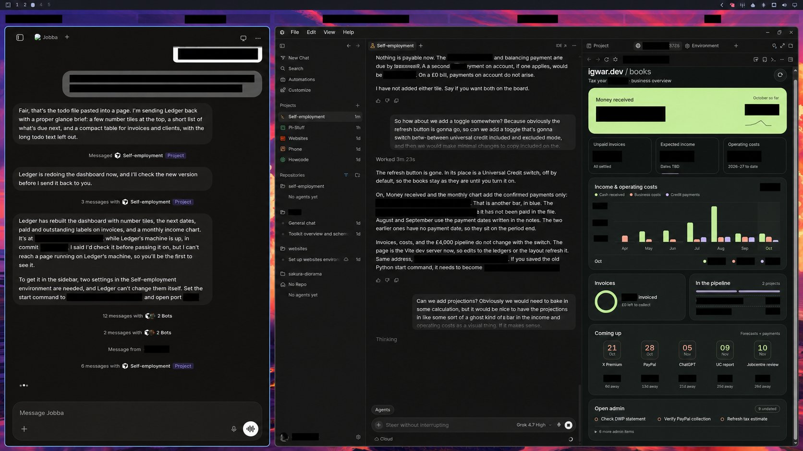

# Sole books

Your sole-trader books, in files you own. Give your agent the figures and evidence, then see your income, costs, invoices and cashflow in one place.

Sole books brings the day-to-day work into a repo: CSV ledgers you can inspect, an agent that helps maintain them, and a read-only dashboard for the bigger picture. Keep track of what has been paid, what is still expected and what needs doing next without hiding the working behind a bookkeeping app.

It is built for UK sole traders using cash-basis records, with cashflow projections and Universal Credit tracking alongside the books.

*How I use it: Grok Bot, Cursor cloud, and the dashboard preview.*

## Try the example

Explore the [worked example](https://github.com/IgorWarzocha/sole-books/tree/demo): a fictional 2026-27 year for Jordan Hale, trading as Hale Studio. See how receipts, expenses and invoices feed the dashboard.

## Make it yours

Keep real records in a private repository. The dashboard is localhost-only and has no login. Keep it that way, or use an authenticated tunnel for remote access.

1. Start with the empty [UK template](https://github.com/IgorWarzocha/sole-books/tree/uk), not the fictional example.
2. Make a private copy for your own books.
3. Ask your agent to set up your books using [SETUP.md](SETUP.md). It will ask for your business details, check what needs researching and help you bring in existing records or work alongside your current tools.
4. Review the setup with your agent before relying on the books. Then give it receipts, paid costs and invoice details as they arrive.

## What you get

- CSV ledgers, cashflow, Universal Credit periods, and a to-do list
- Glance, a read-only dashboard. From the repo root: `npm install --prefix glance`, then `npm run dev --prefix glance`, then open http://127.0.0.1:48173
- Totals with `make summary`, `make cashflow`, and `make check`
- An invoice skeleton in `templates/invoices/`
- Agent-assisted setup, bookkeeping, reconciliation and invoices

The ledger tools need Python 3 and Make. The UC checker and full test suite also need Node.js with its built-in test runner. The dashboard needs npm too. You choose the agent and how it gets access to the repo.

Your books start empty. Setup brings in your existing records or gives you a clean starting point. A zero on the dashboard means no recorded amount, not a reconciled balance.

## You stay in control

Your agent can maintain records, check totals and prepare invoices or reports. You review the evidence and approve anything sent outside the repo. Keep personal books and supporting documents in a private repository, and check what your chosen agent provider can access.

This is a bookkeeping framework, not an accountant or a filing service. Its checks do not certify tax or benefit compliance. Confirm the applicable requirements with HMRC, DWP or a qualified adviser before relying on the figures.

It does not provide Making Tax Digital submissions or VAT accounting. If those apply, use the compatible software and workflows required for your circumstances. UC forecasts depend on your assessment dates and circumstances. They are estimates, not confirmed awards, and complex cases need separate review.

## Licence

MIT. See [LICENSE](LICENSE).
